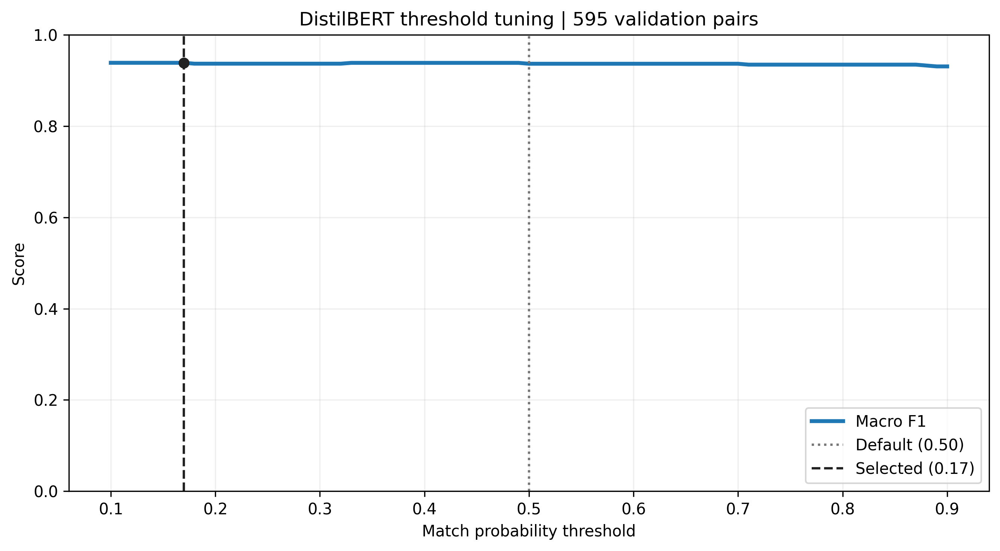

# DistilBERT matcher

Fine-tune DistilBERT for medicine matching, tune the decision threshold on validation pairs, and evaluate the saved test pairs. Run the notebooks in order.

## Run

Use Python 3.12 and the project `.venv` kernel. Required packages are PyTorch, Transformers, safetensors, NumPy, pandas, scikit-learn, Matplotlib, and JupyterLab.

From the repository root:

```powershell
& .\.venv\Scripts\python.exe -m jupyterlab notebooks/PLM_DistilBERT/01_train.ipynb
```

Run each notebook from top to bottom. Model files load locally from `pretrained/`; the commented download cell documents one-time setup. The model is `distilbert/distilbert-base-uncased`, revision `12040accade4e8a0f71eabdb258fecc2e7e948be`. CUDA is used when available; otherwise execution uses CPU.

## 01_train.ipynb

Train a binary classifier using reviewed gold-standard pairs. Input: `data/5_golden_standard_pair/golden_standard_pair_complete/gs_pair_train_val.csv`.

| Setting | Default |
| --- | --- |
| Input attributes | `brandName`, full `activeSubstances` text, `licenceHolder` |
| Serialization | `[COL]` and `[VAL]` field markers |
| Train/validation split | 80/20; stratify by `source_pair`, `hard`, and `match` |
| Batch size / maximum pair length | 16 / 128 tokens |
| Maximum epochs / early-stopping patience | 100 / 20 |
| Objective / optimizer | Cross-entropy / AdamW; LR `2e-5`, weight decay `0.01` |
| Scheduler | CosineAnnealingLR; `T_max=100`, minimum LR `1e-6` |
| Checkpoint selection | Highest validation macro F1 at threshold `0.50` |

Save complete rows to `train_pairs.csv` and `val_pairs.csv`. Save the best weights to `best_model.safetensors`, epoch metrics to `training_history.csv`, and the combined learning curves to `training_curves.png`. Loss uses dashed lines on the left axis; macro F1 uses solid lines on the right. Blue indicates training and orange indicates validation. Training scores are collected during optimization with dropout active; validation uses evaluation mode.

## 02_tune_threshold.ipynb

Load `best_model.safetensors` and `val_pairs.csv`. Sweep thresholds from `0.10` to `0.90` in steps of `0.01`, selecting the highest validation macro F1. Ties favor proximity to `0.50`, then the smaller cutoff.

Outputs: `tuned_threshold.json`, `validation_probabilities.csv`, `threshold_history.csv`, and `threshold_tuning.png`.

## 03_evaluate.ipynb

Load `best_model.safetensors`, `tuned_threshold.json`, and the saved gold-standard `gs_pair_test.csv` from the same data directory. Compare threshold `0.50` with the validation-selected threshold using macro F1.

Save `test_predictions.csv`, `test_metrics.csv`, `test_group_metrics.csv`, and `evaluation_config.json`. Figures cover confusion matrices, source-pair and difficulty breakdowns, and overall macro F1. Error examples appear in separate cells.

## Results

The saved run reached test macro F1 of **0.9193** at the default cutoff and **0.9215** after validation threshold tuning. Tuning produced a small improvement; most predictions stayed unchanged.

### Training

The best checkpoint was saved at epoch 16. Early stopping ended training at epoch 36 after 20 epochs without a better validation macro F1.

| Measure | Result |
| --- | ---: |
| Training / validation pairs | 2,378 / 595 |
| Best-epoch training macro F1 | 0.9949 |
| Best validation macro F1 at cutoff 0.50 | 0.9366 |
| Epochs completed | 36 |
| Total recorded epoch time | 7.54 hours |

Notebook: [01_train.ipynb](01_train.ipynb). Input: `gs_pair_train_val.csv` in the shared gold-standard directory. Outputs: [training_history.csv](training_history.csv), [learning curves](training_curves.png), and `best_model.safetensors`.

### Threshold tuning

Changing the threshold has little effect on validation macro F1 across the tested range. The selected cutoff improves validation macro F1 by 0.0021 and changes three of the 595 validation predictions.

| Threshold comparison | Validation macro F1 |
| --- | ---: |
| Default cutoff: 0.50 | 0.9366 |
| Selected cutoff: 0.17 | 0.9387 |
| Range across all 81 cutoffs from 0.10 to 0.90 | 0.9308–0.9387 |

About 99% of validation probabilities are below 0.10 or above 0.90. Moving the cutoff within this interval therefore affects few pairs, which explains the mostly flat macro F1 curve.



Notebook: [02_tune_threshold.ipynb](02_tune_threshold.ipynb). Inputs: `best_model.safetensors` and [val_pairs.csv](val_pairs.csv). Outputs: [validation_probabilities.csv](validation_probabilities.csv), [threshold_history.csv](threshold_history.csv), and [tuned_threshold.json](tuned_threshold.json).

### Test evaluation

Both cutoffs use the same 525 saved test pairs. The selected cutoff changes one prediction, recovering one true match; the test macro F1 gain is 0.0022.

| Configuration | Threshold | Macro F1 | True positives | False positives | False negatives |
| --- | ---: | ---: | ---: | ---: | ---: |
| Default | 0.50 | 0.9193 | 159 | 11 | 27 |
| Validation-tuned | 0.17 | 0.9215 | 160 | 11 | 26 |

| Group | Pairs | Default macro F1 | Tuned macro F1 |
| --- | ---: | ---: | ---: |
| DPD–EMA | 150 | 0.9246 | 0.9246 |
| DPD–FDA | 116 | 0.9194 | 0.9194 |
| EMA–FDA | 259 | 0.9138 | 0.9186 |
| Ordinary (`hard=0`) | 290 | 0.9592 | 0.9592 |
| Difficult (`hard=1`) | 235 | 0.8739 | 0.8787 |

Difficult pairs remain the main performance gap. Source-pair groups and difficulty groups describe overlapping views of the same test set; macro F1 is calculated within each group. The threshold was selected using validation labels.

Notebook: [03_evaluate.ipynb](03_evaluate.ipynb). Inputs: `gs_pair_test.csv`, `best_model.safetensors`, and `tuned_threshold.json`. Outputs: [test_predictions.csv](test_predictions.csv), [test_metrics.csv](test_metrics.csv), [test_group_metrics.csv](test_group_metrics.csv), and [confusion matrices](test_confusion_matrices.png).

## Processing notes

- `make_dataset` serializes and tokenizes labeled medicine pairs. Prediction collection, loss aggregation, and scoring stay inline.
- Outputs are saved directly in this folder. Training protects existing weights and history unless `overwrite_training=True`; data preparation rewrites the two split CSVs.
- Run training before tuning, and tuning before evaluation. Keep input settings consistent across notebooks and rerun tuning after retraining.
- `pretrained/`, `.hf_cache/`, and the extracted `best_model.safetensors` are excluded from Git. The checkpoint is versioned as `best_model.zip` through Git LFS. Run `git lfs pull`, then `Expand-Archive notebooks/PLM_DistilBERT/best_model.zip notebooks/PLM_DistilBERT` from the repository root before tuning or evaluation. The pretrained classification-head initialization warning is expected; fine-tuning learns the matching head.
