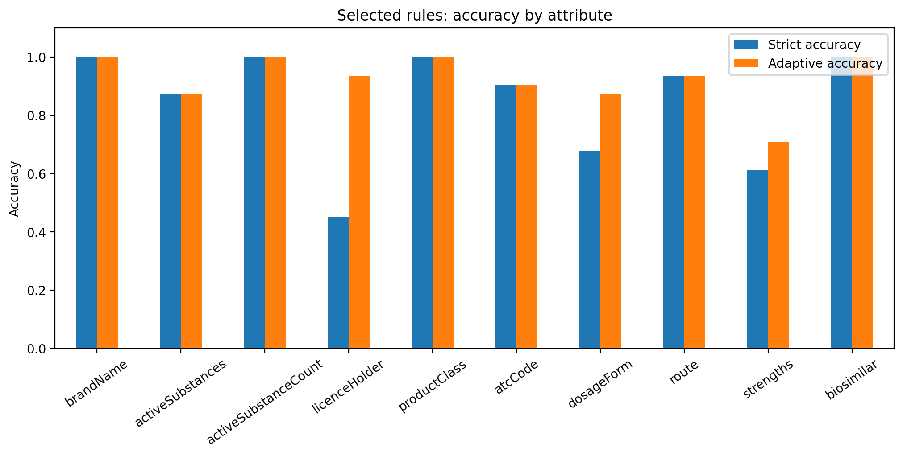
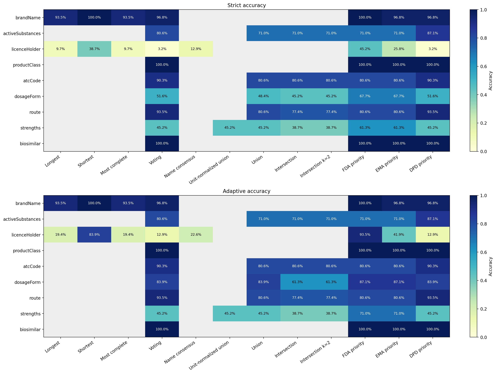

# Data fusion rule experiment report

The selected attribute rules achieve **92.26% adaptive accuracy** and **84.52% strict accuracy** on 31 reviewed medicine groups. Built-in voting and source-priority rules form the final configuration; the experiment also tested two custom fusion functions and developed three attribute-specific evaluation comparisons.

## 1. Experiment scope

The experiment uses the source values and gold values already present in the evaluation worksheet. Correspondence clustering is a separate study.

| Item | Setup |
|---|---|
| Executable experiment | [data_fusion_rule_experiment.ipynb](data_fusion_rule_experiment.ipynb) |
| Input | [fusion_eval_worksheet.csv](../../data/8_fusion_eval/fusion_eval_worksheet.csv) |
| Evaluation sample | 31 medicine groups: 19 pairs and 12 triplets |
| Source memberships in the worksheet | DPD: 24; EMA: 27; FDA: 23 |
| Evaluated attributes | 10 per medicine, giving 310 attribute comparisons |
| Fusion targets | 9 attributes; `activeSubstanceCount` is derived from fused `activeSubstances` |
| Preparation | Lowercase and normalize whitespace in strings; convert lists, strength pairs, counts and booleans |
| Baseline | Longest string for text, voting for categories, union for sets |
| Rule experiments | Test applicable functions per attribute while keeping other attributes at baseline |
| Final assessment | Combine the selected attribute rules and evaluate the complete configuration |

The ten evaluated attributes follow the [evaluation-set guide](../../src/data_fusion/role2_eval_set.md). Six additional schema fields were excluded for the following reasons:

| Excluded fields | Reason |
|---|---|
| `usApprovalDate`, `euAuthorisationDate`, `caStatusDate` | Each field belongs to one source's jurisdiction, so there is no cross-source conflict for that date |
| `regulatoryStatus`, `generic`, `orphanMedicine` | Their meanings depend on the jurisdiction; a single gold value requires a jurisdiction policy |

For example, US approval and EU authorisation dates describe different events, and a medicine can have different regulatory statuses in Canada and the EU. The full-data pipeline retains these six fields using PyDI's default first-available-value behavior; their fusion accuracy was outside this study. `activeSubstanceCount` contributes to the ten evaluated attributes through derivation from fused `activeSubstances`.

Built-in candidates cover longest/shortest string, most complete, voting, union, intersection, intersection with `k=2`, and source priority where applicable. Voting uses the current equal source weights. Priority orders are **FDA → EMA → DPD**, **EMA → FDA → DPD**, and **DPD → EMA → FDA**, implemented through trust weights 3, 2 and 1. A missing higher-priority value allows selection from the next available source.

**Evidence:** notebook §§2, 4–5; [attribute_metrics.csv](csv/attribute_metrics.csv) records every attribute–rule score.

## 2. Adaptive accuracy and custom comparisons

Strict evaluation initially exposed differences in naming, units, rounding and description granularity. Adaptive accuracy measures agreement under explicit attribute-specific comparisons. Both scores remain visible, and all candidate fusion functions use the same comparisons.

| Observed problem | Actual example | Adaptive comparison | Interpretation limit |
|---|---|---|---|
| Shortened `licenceHolder` names | Elelyso: `pfizer` versus gold `pfizer inc.`; Kanuma: `alexion pharm` versus `alexion pharmaceuticals, inc.` | Character similarity ≥0.85, or one-to-one token matches covering the shorter name; tokens can match by similarity ≥0.85 or a shared prefix of at least three characters | Measures name resemblance; legal-company identity requires additional evidence |
| Compatible `strengths` units | Praxbind: `0.05 g/mL` versus gold `50 mg/mL` | Use Pint and Decimal to convert mass to mg and mass/volume to mg/mL | An amount such as `50 mg` needs volume information to be compared with `50 mg/mL` |
| Rounded `strengths` | Wegovy: `2.266667 mg/mL` versus gold `2.27 mg/mL` | Allow relative numeric difference ≤0.5%, with one-to-one matching of complete strength sets | Extra or missing pairs remain errors; ranges retain their endpoints |
| Different `dosageForm` granularity | Elelyso: `powder` versus `powder for solution`; Kesimpta: `solution` versus `injection` with subcutaneous route | Compare powder families; group `solution`, `injection` and `concentrate` into an injectable-liquid family when all available source routes are parenteral | Measures broad form-family agreement; preparation and dilution details still matter |

For `licenceHolder`, punctuation is removed before comparison. Token matching uses maximum bipartite matching so a word can satisfy only one match. For `strengths`, the same matching approach enforces a complete one-to-one correspondence; accepted pairs have equal normalized units and equal numbers of range endpoints. Numeric closeness uses `|a − b| ≤ 0.005 × max(|a|, |b|)`.

The `dosageForm` comparison uses all source routes for each medicine. For example, Wegovy includes oral and subcutaneous routes, so `solution` and `injection` remain distinct under the current route condition. Unsupported units retain their original meaning.

### Effect on the selected configuration

| Attribute | Strict matches | Adaptive matches | Additional accepted matches |
|---|---:|---:|---:|
| `licenceHolder` | 14/31 (45.16%) | 29/31 (93.55%) | 15 |
| `dosageForm` | 21/31 (67.74%) | 27/31 (87.10%) | 6 |
| `strengths` | 19/31 (61.29%) | 22/31 (70.97%) | 3 |
| All 10 attributes | 262/310 (84.52%) | 286/310 (92.26%) | 24 |

The 24 additional accepted matches come from the evaluation comparisons. The strict and adaptive scores evaluate the same fused output.

**Evidence:** notebook §3 defines `holder_name_match`, `normalize_strengths`, `strength_match` and `dosage_form_match`; [selected_rule_errors.csv](csv/selected_rule_errors.csv) contains the values and both match flags.

## 3. Custom fusion attempts

Two custom functions attempted to improve the fused values. They were tested alongside the built-in candidates.

| Attribute | Custom fusion method | Strict accuracy | Adaptive accuracy | Selected built-in rule: strict / adaptive |
|---|---|---:|---:|---:|
| `licenceHolder` | Name consensus: retain the source name with the highest mean character similarity to all source names | 4/31 (12.90%) | 7/31 (22.58%) | FDA priority: 45.16% / 93.55% |
| `strengths` | Unit-normalized union: convert compatible units, deduplicate pairs and union the source sets | 14/31 (45.16%) | 14/31 (45.16%) | FDA priority: 61.29% / 70.97% |

**Name consensus:** similarity between regional names can favor a different company description from the gold value. For Bosulif, the custom rule selects `pfizer canada ulc`; FDA priority selects `pf prism cv`, matching gold `pf prism c.v.` under the name comparison. For Cinqair, consensus selects `teva canada limited`, while FDA supplies `teva respiratory llc` and gold is `teva respiratory, llc`. Source-name agreement provides insufficient evidence for the intended gold entity in these examples.

**Unit-normalized union:** compatible conversion alone cannot remove differences in product scope or quantity dimensions. For Praxbind, the custom union produces `[(50, mg), (50, mg/mL)]` from DPD and FDA. Gold contains only `[(50, mg/mL)]`, so the extra amount keeps the set incorrect. The custom rule ties ordinary union at 45.16% and falls below FDA priority.

Both custom fusion functions scored below the best candidates and therefore stayed outside the highest-score tie groups. The custom evaluation comparisons continue to contribute to adaptive scoring.

**Evidence:** notebook §§3.1–3.2 and the `licenceHolder`/`strengths` tests in §5; functions `holder_consensus` and `normalized_strength_union`; [attribute_metrics.csv](csv/attribute_metrics.csv).

## 4. Rule selection and tie-breakers

Selection first maximizes adaptive accuracy, then strict accuracy. A remaining tie keeps the simple baseline rule when that rule is among the finalists. The following manual choices resolve the remaining five ties.

| Attribute | Equally best finalists after score checks | Manual selection |
|---|---|---|
| `brandName` | Shortest; FDA priority | FDA priority |
| `atcCode` | Voting; DPD priority | Voting |
| `dosageForm` | FDA priority; EMA priority | FDA priority |
| `route` | Voting; DPD priority | Voting |
| `strengths` | FDA priority; EMA priority | FDA priority |

These choices preserve the tied development scores. FDA-priority and EMA-priority outputs are identical on this sample for `dosageForm` and `strengths`; their tie gives no evidence of a general advantage for either priority order. Voting is retained through the baseline tie-breaker for `productClass` and `biosimilar`.

### Final configuration

| Attribute | Selected rule | Strict accuracy | Adaptive accuracy |
|---|---|---:|---:|
| `brandName` | FDA priority | 100.00% | 100.00% |
| `activeSubstances` | DPD priority | 87.10% | 87.10% |
| `activeSubstanceCount` | Count unique fused `activeSubstances` | 100.00% | 100.00% |
| `licenceHolder` | FDA priority | 45.16% | 93.55% |
| `productClass` | Voting | 100.00% | 100.00% |
| `atcCode` | Voting | 90.32% | 90.32% |
| `dosageForm` | FDA priority | 67.74% | 87.10% |
| `route` | Voting | 93.55% | 93.55% |
| `strengths` | FDA priority | 61.29% | 70.97% |
| `biosimilar` | Voting | 100.00% | 100.00% |

**Evidence:** notebook §§6.3–6.7; [tied_rules.csv](csv/tied_rules.csv) records ties before the manual choices, and [selected_rules.csv](csv/selected_rules.csv) records the final configuration.

## 5. Combined experiment results

The selected rules improve accuracy while preserving the baseline's coverage.

| Measure | Simple baseline | Selected rules | Change |
|---|---:|---:|---:|
| Strict accuracy | 221/310 (71.29%) | 262/310 (84.52%) | +13.23 percentage points |
| Adaptive accuracy | 235/310 (75.81%) | 286/310 (92.26%) | +16.45 percentage points |
| Density | 309/310 (99.68%) | 309/310 (99.68%) | Unchanged |
| Mean input consistency | 77.31% | 77.31% | Unchanged |

- **Accuracy:** matched gold attribute values divided by evaluated attribute values. Overall accuracy averages the ten attribute accuracies; every attribute has 31 gold values.
- **Density:** populated fused attribute cells divided by 310 cells.
- **Input consistency:** for each attribute, the fraction of multi-record source groups whose available values agree under the original comparison; groups without an available value are omitted. The reported overall value averages the ten attribute consistencies. This source diagnostic stays fixed across fusion configurations.

Strict text evaluation uses PyDI's tokenized comparison, sets use equal membership, and counts/booleans use exact comparison. The adaptive comparisons change only the three attributes described in §2.

**Evidence:** notebook §§6.4–6.8; [combined_metrics.csv](csv/combined_metrics.csv), [fusion_density.csv](csv/fusion_density.csv), [input_consistency.csv](csv/input_consistency.csv), and [selected_fused_sample.csv](csv/selected_fused_sample.csv).

## 6. Remaining errors and interpretation

The selected configuration has 24 adaptive mismatches: 9 in `strengths`, 4 each in `activeSubstances` and `dosageForm`, 3 in `atcCode`, and 2 each in `licenceHolder` and `route`.

| Remaining problem | Observed example | Implication for further study |
|---|---|---|
| Missing source information | Vijoice has no available `dosageForm`; gold contains `granules` and `tablet` | Fusion needs additional source information to recover these values |
| Amount versus concentration | Leqembi supplies `100 mg`; gold is `100 mg/mL` | A documented volume would be needed for conversion |
| Presentation-specific units | Elelyso supplies `200 U/vial`; gold is `200 U` | Packaging context is required to establish comparability |
| Additional product variants | Vijoice includes an extra `50 mg/packet` strength alongside `50 mg`, `125 mg` and `200 mg`; gold contains the three mg values | Study variant scope and packaging semantics before removing the extra pair |
| Mixed-route product families | Wegovy voting selects only `subcutaneous`; gold includes `oral` and `subcutaneous` | Whole-set voting can omit a route supplied by one source |

The custom work contributes automatic name matching, dimensional unit conversion, tolerance-aware one-to-one strength matching, route-conditioned form comparison and a derived substance count. The tested custom fusion functions remain unsuccessful candidates in this sample. Further work can use their recorded failures to design targeted improvements.

These results describe development performance: the same 31 groups supported rule selection and final assessment. A separate held-out evaluation is needed to estimate generalization. The sample's gold scope and source coverage can also influence source-priority performance.

**Evidence:** notebook §6.8; [selected_rule_errors.csv](csv/selected_rule_errors.csv) includes source inputs, fused values, gold values and strict/adaptive flags.

## 7. Artifacts for follow-up work

Run the notebook from top to bottom to reproduce the experiment. It saves tables in `csv/` and figures in `figures/` within this experiment folder.

| Artifact | Use |
|---|---|
| [attribute_metrics.csv](csv/attribute_metrics.csv) | Compare every candidate, including both custom fusion functions |
| [selected_rules.csv](csv/selected_rules.csv) | Recover the final choices and per-attribute results |
| [combined_metrics.csv](csv/combined_metrics.csv) | Recover baseline and final overall metrics |
| [selected_rule_errors.csv](csv/selected_rule_errors.csv) | Inspect the final mismatches with their source inputs |
| [tied_rule_values.csv](csv/tied_rule_values.csv) | Inspect outputs produced by tied best candidates |
| [figures/](figures/) | Accuracy heatmaps, selected-rule accuracy, density and input consistency |

Notebook §3 contains the custom definitions, §4 contains rule settings and evaluation orchestration, §5 contains attribute experiments, and §6.3 contains the score-based checks followed by manual tie-breakers.

